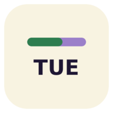
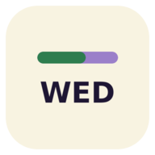
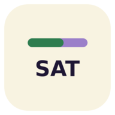

# StudyBloom

<p align="center">
  
</p>

<p align="center">
  <strong>Plan gently. Learn consistently. Grow every day.</strong><br>
  <em>Your learning journey begins here.</em>
</p>

<p align="center">
  
  
  
  
  
  
</p>

---

## 📖 Overview

**StudyBloom** is a native, offline-capable Android application built with Kotlin and Jetpack Compose for students, programmers, and self-directed learners.

StudyBloom pairs an **intelligent AI study engine** with **Multiple Daily Study Goals**, an **aesthetic task clock & live study timer**, automated multi-day scheduling, a **dynamic weekday launcher icon**, and a local-first Room SQLite database (v6). Learners can start immediately in Guest Mode with zero forced registration, add their own daily study goals or upload learning materials, build realistic study blocks, and track genuine focus time across sessions.

---

## 🌟 What's New

### 📆 Dynamic Weekday Launcher Icon (`MON` – `SUN`)
* **Minimal Branded Icon Design:** Warm cream (`#F8F3E1`) rounded-square & circular adaptive icon with a horizontal two-tone progress bar (`#2E7D4F` green left / `#9B7FC9` soft purple right) and bold deep-plum weekday abbreviation (`#1E1633`).
* **Seven Automatic Daily Variations:** Automatically displays `MON`, `TUE`, `WED`, `THU`, `FRI`, `SAT`, or `SUN` based on the device's current local date and timezone:
  <p align="center">
    
    
    
    
    
    
    
  </p>
* **Safe `<activity-alias>` Switching:** Powered by `WeekdayIconManager` using 7 manifest `<activity-alias>` entries pointing to `.MainActivity`. Enables the target weekday alias first (`PackageManager.DONT_KILL_APP`) before disabling the others—guaranteeing a single launcher icon with zero duplicate shortcuts and preserving all notification and deep-link launches.
* **Background & System Sync Resilience:** Synchronized on cold launch and foreground return (`StudyBloomApplication` + `ProcessLifecycleOwner` and `MainActivity.onResume`), via **WorkManager** (`WeekdayIconWorker` running 6-hour periodic checks plus computed next-midnight checks), and via `WeekdayChangeReceiver` on `BOOT_COMPLETED`, `TIME_SET`, `TIMEZONE_CHANGED`, `DATE_CHANGED`, and `MY_PACKAGE_REPLACED`.

### 🎯 Multiple Daily Study Goals & Multi-Goal Scheduling
* **Dedicated Goal Management (`StudyGoalEntity`):** Create, edit, reschedule, complete, and delete multiple daily study goals with subject, category, priority (`HIGH`, `MEDIUM`, `LOW`), difficulty (`EASY`, `MEDIUM`, `HARD`), estimated target minutes, preferred date, and optional deadlines.
* **Multi-Goal Schedule Wizard:** Select one or more active goals in `ScheduleWizardScreen`, automatically split or pack blocks into available daily study capacity, and redistribute overflow sessions across upcoming days.
* **Accurate Transactional Progress Tracking:** Timer and focus sessions record a unique `sessionSubmissionKey` to prevent duplicate submissions and double-counting while atomically updating `actualMinutes` on linked goals.
* **Isolated Data Ownership & Migration:** Every study goal belongs to its owner (`guest` or `user:<email>`), preserves isolation between sessions, transfers cleanly during guest-to-account migration, and syncs via `SyncManager`.
* **Non-Destructive Room v6 Migration:** Full migration path (`MIGRATION_1_2` through `MIGRATION_5_6`) preserves all existing user tasks (with `goalId = NULL`), study sessions, materials, and profile preferences.

### ✨ Redesigned Login / Welcome Screen
* **Clean Split-Canvas Aesthetic:** Warm cream (`#F8F3E1`) upper canvas with centered `StudyBloom` branding transitioning cleanly at the secondary pill button to a pure white (`#FFFFFF`) lower card area.
* **Clear Three-Option Entry Flow:**
  * **Continue as Guest** (`#2E7D4F`) — initializes a valid guest session with full access to guest-supported features.
  * **Create an Account** (`#9B7FC9`) — opens registration and the 5-step verified migration flow.
  * **Already have an account? Sign In** (`#F0F0F0` rounded card) — opens the sign-in flow for returning users.

### 🧹 Clean Slate — Zero Demo or Placeholder Data
* **Real User Data Only:** Removed all pre-populated demo accounts, sample tasks, mock schedules, fake subjects, sample study documents, and artificial timer histories.
* **Guided Empty States:** Fresh installations begin with a clean local profile (`StudyBloomDatabase` clean initial callback) and helpful empty states prompting users to create real goals, tasks, and materials.

### 🛠️ Profile & Study Focus + Session Reminder UI Fixes
* **Responsive Daily Study Target Selector:** Fixed alignment, vertical spacing, horizontal padding, and wrapping for the hour-selection boxes in **Profile & Study Focus** so every chip stays cleanly inside screen bounds across small and large Android displays.
* **Polished Session Reminder Layout:** Fixed label overlap, control alignment, switches, time selectors, and minimum 48dp accessible touch targets across the **Reminders & Notifications** section while preserving all existing reminder preferences and scheduling logic.

---

## 📱 Core Features

| Feature | Description |
|---|---|
| **🎯 Multiple Daily Study Goals** | Create and track multiple daily goals with estimated vs. actual minutes, status badges (`Unscheduled`, `Partial`, `Scheduled`, `Completed`), and date rescheduling. |
| **📚 AI Material Breakdown** | Upload textbooks, notes, or code snippets (PDF, TXT, Code). AI extracts modules, difficulty levels, prerequisites, and time estimates. |
| **📅 Intelligent Schedule Wizard** | Multi-step planner supporting both subject-based and multi-goal scheduling around wake/sleep times, peak focus hours, and breaks without double-booking. |
| **⏱️ Aesthetic Task Clock & Focus Timer** | Circular analog study clock with live elapsed/remaining countdowns, overtime tracking, persistent `ActiveTimerPill`, and quick Pomodoro focus mode. |
| **📆 Dynamic Weekday App Icon** | Launcher icon automatically updates to show the current local weekday (`MON`–`SUN`) across foreground switches, midnight rollovers, reboots, and timezone changes. |
| **🤖 Contextual AI Assistant** | In-app study mentor sheet for real-time advice, concept breakdowns, and schedule adjustments. |
| **📈 Progress & Analytics** | Daily and weekly focus charts, completion metrics, study streak tracking, and authentic session histories. |
| **📄 PDF & CSV Schedule Export** | Exports printable daily/weekly study schedules to PDF (`PdfDocument`) and CSV files. |
| **🔔 Reminders & Notifications** | Configurable pre-session reminders, daily planning prompts, evening summaries, and active task clock notifications. |
| **🌐 Offline-First Sync & Guest Migration** | Real-time connectivity monitoring (`Online`, `Offline Mode`, `Syncing...`), queued offline AI requests (`PendingAiRequestEntity`), and 5-step verified Guest-to-Account cloud migration. |

---

## 🛠️ Technical Architecture & Stack

StudyBloom follows **Clean Architecture** and **MVVM** with Jetpack Compose and an offline-first Room repository layer:

```text
app/src/main/java/com/example/
├── MainActivity.kt                      # Edge-to-edge entry point & resume weekday icon sync
├── StudyBloomApplication.kt             # ProcessLifecycleOwner observer & WorkManager setup
├── icon/
│   ├── WeekdayIconManager.kt            # Weekday resolution & safe activity-alias switching
│   ├── WeekdayIconWorker.kt             # 6h periodic + next-midnight WorkManager scheduler
│   └── WeekdayChangeReceiver.kt         # Boot, time, timezone, date & package-replaced receiver
├── ui/
│   ├── StudyBloomApp.kt                 # Central navigation scaffold, dialogs & sheet controllers
│   ├── theme/                           # Material 3 colors, typography & shapes
│   ├── screens/
│   │   ├── LoginScreen.kt               # Redesigned split-canvas Welcome / Auth entry screen
│   │   ├── HomeScreen.kt                # Today's goals, tasks, streak pill & quick actions
│   │   ├── TaskClockScreen.kt           # Fullscreen aesthetic circular timer
│   │   ├── FocusTimerScreen.kt          # Quick Pomodoro focus timer
│   │   ├── MyPlanScreen.kt              # Calendar-based daily/weekly tasks & goals planner
│   │   ├── ScheduleWizardScreen.kt      # Multi-goal & AI schedule generator with overflow split
│   │   ├── MaterialsScreen.kt           # Study documents, topic breakdown & AI extraction
│   │   ├── ProgressScreen.kt            # Focus charts, streak statistics & session history
│   │   ├── ProfileScreen.kt             # Study Focus targets, Session Reminders, sync & account
│   │   └── OnboardingScreen.kt          # Personalization preferences
│   ├── components/
│   │   ├── GoalComponents.kt            # DailyGoalCard, Add/Edit, Reschedule & Delete dialogs
│   │   ├── AuthDialog.kt                # Account registration & sign-in modal
│   │   ├── AccountCreationReminderDialog.kt # Non-intrusive progress protection prompt
│   │   ├── ActiveTimerPill.kt           # Persistent live timer pill above bottom navigation
│   │   ├── ConnectionStatusIndicator.kt # Real-time online/offline network status & sheet
│   │   ├── AiAssistantSheet.kt          # Interactive AI study assistant modal
│   │   ├── AddTaskDialog.kt             # Manual task creation & goal linking
│   │   └── ExportDialog.kt              # PDF / CSV schedule export modal
│   └── viewmodel/
│       └── StudyBloomViewModel.kt       # Centralized StateFlow UI state & coroutine actions
├── data/
│   ├── local/                           # Room Database (v6, non-destructive migrations v1→v6)
│   │   ├── StudyBloomDatabase.kt
│   │   ├── dao/                         # DAOs for Goals, Tasks, Sessions, Materials, Topics, Profile, AI Queue
│   │   └── entity/                      # Room entities including StudyGoalEntity & GoalOwnership
│   ├── auth/
│   │   └── AuthManager.kt               # Guest-to-Account 5-step verified migration engine
│   ├── ai/
│   │   ├── AiRepository.kt              # AI interface
│   │   └── AiRepositoryImpl.kt          # Firebase AI Logic / Gemini & offline queue fallback
│   ├── sync/
│   │   └── SyncManager.kt               # Cloud sync orchestrator, goal ownership & AI queue processor
│   └── repository/
│       └── StudyBloomRepository.kt      # Unified offline-first repository & transactional logging
└── util/
    ├── NetworkConnectivityMonitor.kt    # ConnectivityManager callback & active network checks
    ├── TaskTimerManager.kt              # Timestamp-based resilient study clock manager
    ├── NotificationHelper.kt            # Notification channels, reminders & clock notifications
    └── PdfExporter.kt                   # Native Android PdfDocument & CSV generation
```

### Technology Matrix

* **Language:** Kotlin 2.2.10
* **UI Toolkit:** Jetpack Compose (BOM `2024.09.00`) with Material 3
* **Navigation:** Jetpack Navigation Compose (`2.8.9`)
* **Local Persistence:** Room Database `2.7.0` (Schema **v6** with `MIGRATION_1_2`..`MIGRATION_5_6`) + DataStore Preferences (`1.1.7`)
* **Background Work:** AndroidX WorkManager `2.10.0` + Lifecycle Process `2.8.7`
* **Asynchronous Flow:** Kotlin Coroutines `1.10.2` & `StateFlow`
* **Networking & Serialization:** Retrofit `2.12.0`, OkHttp `4.10.0`, Moshi `1.15.2` (KSP codegen)
* **AI Capabilities:** Firebase AI Logic (`firebase-bom:34.17.0`) + App Check
* **Document Export:** Native Android `android.graphics.pdf.PdfDocument`
* **Testing:** JUnit 4, Robolectric `4.16.1`, AndroidX WorkManager Testing (`2.10.0`), Compose UI Test (`ui-test-junit4`)

---

## 🚀 Getting Started

### Prerequisites
* **Android Studio:** Ladybug / Meerkat or newer
* **Android SDK:** Compile SDK 36, Target SDK 36, Minimum SDK 24 (Android 7.0 Nougat)
* **JDK:** Java 11+ (Java 17 recommended)

### Building & Testing

1. **Clone the repository:**
   ```bash
   git clone https://github.com/YOUR_USERNAME/StudyBloom.git
   cd StudyBloom
   ```

2. **Environment Secrets (Optional):**
   Manage API keys via the AI Studio Secrets panel or `.env` (see `.env.example`). Never commit `.env` or hardcode secrets.

3. **Build Debug APK:**
   ```bash
   gradle assembleDebug
   ```

4. **Run Unit & Robolectric Tests:**
   ```bash
   gradle :app:testDebugUnitTest
   ```
   Verified test suites include:
   * `DynamicWeekdayIconTest` — All 7 weekday aliases (`MON`–`SUN`), month/year/leap-year boundaries, timezone crossings, system broadcasts, WorkManager execution, icon resources, and `MainActivity` launch.
   * `DatabaseMigrationTest` — Room schema v5 → v6 and legacy upgrade safety.
   * `GoalRepositoryAndProgressTest` — Transactional progress logging, duplicate submission prevention, and goal ownership isolation.
   * `MultiGoalSchedulerTest` — Multi-goal scheduling and overflow redistribution.
   * `GoalUiTest` & `ProfileReminderUiTest` — Compose UI interactions for daily goals, Daily Study Target chips, and Session Reminders.
   * `Stage5IntegrationAndSyncTest` & `ExampleUnitTest` — Guest-to-account migration, connectivity handling, and cloud sync.

---

## 🔒 Privacy, Security & Data Ownership

* **Local-First Privacy:** Goals, tasks, learning materials, topic notes, and focus sessions are stored locally on-device in Room SQLite with zero pre-loaded mock or demo entries.
* **No Forced Cloud Lock-In:** Guest Mode provides full local study planning, timers, and goal tracking without requiring an account.
* **Ownership Isolation & Safe Migration:** Guest and registered user data remain isolated by owner ID, and guest-to-account upgrades preserve and verify all local goals, tasks, sessions, and materials.

---

## 📄 License

StudyBloom is open-source software licensed under the [Apache License, Version 2.0](LICENSE).
